> **Living painted scenes — 2026-11-02.** **Current private candidate:** `2.13.0`.
> One family of animated adults now runs through all 240 scenes, 157 of the 165 paintable scenes sit on painted
> gouache settings with dark-theme versions, and every scene wakes with a short, finite motion when it scrolls into
> view. **Latest published release:** `v2.12.2`. The staging host is redeployed by hand from `main`, so it can trail
> the source; its `/version` endpoint reports what it runs.
> Details: [Visual Bible](docs/VISUAL_BIBLE.md) · [Living Scenes pilot](docs/LIVING_SCENES_PILOT.md).

  

  <h1>Ivrit Sheli 2.13.0 — Living Hebrew for every day</h1>
  
<strong>A trilingual, local-first PWA for learning the Hebrew people meet in everyday life.</strong>

  
Guided enough for a complete beginner, deep enough to keep growing.

  
Made for adults in Israel who are new to Hebrew, and often to apps, and who read Spanish or English.

  

    
    
    
    
    
    
  

  

    
    
  

 

> **The Living Hebrew Journey** — explore a beautifully crafted, evidence-based learning environment with 240 exact semantic scenes that adapts to your language, your pacing, and your daily life in Israel. Privacy is built-in; your progress stays local by default until you decide to back it up.

## 🎨 2.13.0 — Living, painted scenes

  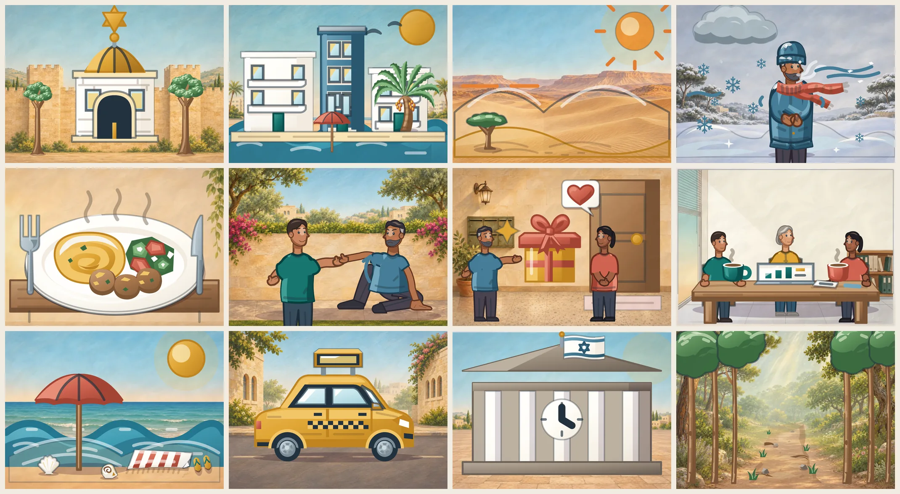

  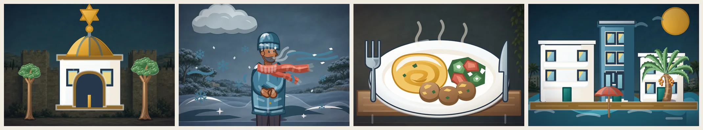

<em>Captured from the 2.13.0 candidate on 2026-11-02: light theme above, dark theme below.</em>

Every word in the starter catalog is taught by a scene, and in 2.13.0 those scenes grew up:

- **Painted places, vector meaning.** Settings are gouache paintings of everyday Israel — the Negev, the Carmel,
  Jerusalem stone, the Tel Aviv seafront, kitchens, clinics and bus stops — each with a dark-theme version at the same
  time of day. People, hands, the objects that teach the word and everything that moves stay SVG, so the three
  teaching layers (context → meaning → anchor) still reveal one by one.
- **A glaze, not a collage.** Where a teaching shape covers the ground (dunes, a field, the sea, a road), it keeps its
  outline and a light wash, and the painting shows through.
- **One family of people.** Four adults with three-quarter faces, sleeves, hands with a thumb and real shoes appear in
  every scene; the feminine and masculine grammar scenes rely on them.
- **Alive, never restless.** A tap or a key replays the scene's teaching motion. When a card scrolls into view it wakes
  once — a breath, a blink, steam rising, a crown swaying — and is still again within five seconds (WCAG 2.2.2).
  Reduced motion shows complete stills, and thumbnails never move on their own.
- **Built to grow.** Shared painted walls (a kitchen, a living room, a study) and a painted desk sit behind object and
  document scenes, so a new word starts at the same quality. Maps, arrows and notice cards stay drawn: there the
  schema is what teaches.
- **Remembered choices.** The interface language and theme a learner picks are saved with their profile, and Today
  greets them by the name they chose.

## 🏛️ Learning Hubs & Experience Depth

  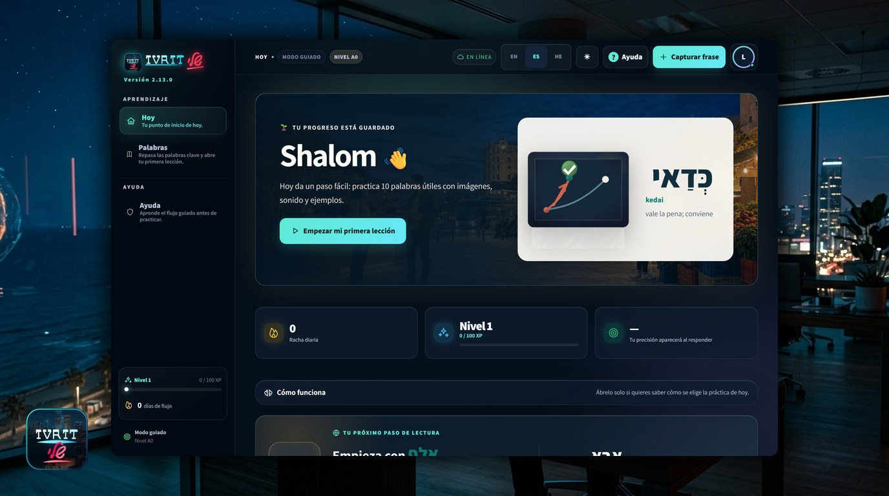

The platform is organized into living, stable learning hubs. Their visible names prioritize clear actions, while internal routes provide semantic stability:

- **Today (היום)** — Your daily starting point. Actionable phrases, retention algorithms, and daily flow.
- **Alphabet Studio** — Foundation building. 22 base letters, 5 final forms, and vowel maps.
- **Dictionary (מילון)** — Your semantic anchor. Root-based connections, exact trilingual translations, and audio.
- **AI Coach (Beta)** — Real-time conversation simulation and grammatical feedback driven by offline-capable models.
- **Settings** — Deep personalization. Switch between 14 aesthetic themes, toggle RTL interfaces, and manage your local data vault.

Three persistent depths change how information is presented without hiding rooms or confusing the learner:

- **Guided** — uses simpler language, removes complex grammatical terms, and keeps context visible.
- **Explorer** — the balanced default: a calm, self-directed visit.
- **Deep Dive** — exposes linguistic roots, transliteration details, exact stats, and advanced controls.

## 🌍 Language, Themes and Accessibility

  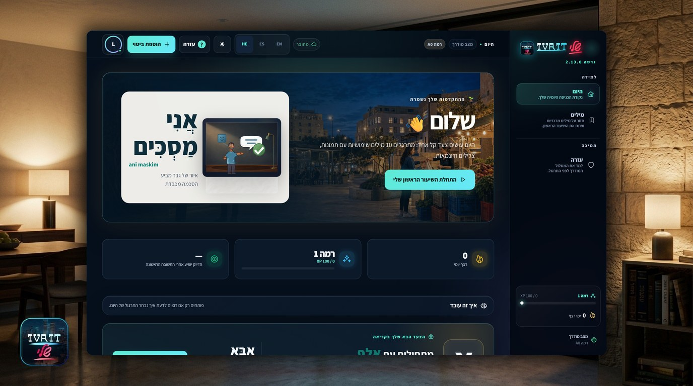

  

- **Trilingual Core:** English, Spanish, and Hebrew interfaces working seamlessly together.
- **RTL Architecture:** Genuine Right-to-Left document direction and `he-IL` formatting that respects the language.
- **Expressive Aesthetics:** 14 distinct dark and light themes. 
- **Accessibility First:** Keyboard-aware navigation, focus restoration, and mobile drawer behavior.
- **Motion Polish:** Reduced-motion support across application transitions, elegant charts, and static repository artwork.

---

## 🚀 Live Staging & Deployment

  

The private candidate source on `main` runs on a free Render service that is redeployed by hand.
That service is **verified staging for a private pilot, not production**: the gates in the
table below were exercised against the live host on 2026-08-27 with 2.12.3, while the human
gates — Hebrew-content acceptance and the first real learner — remain open.

On 2026-11-02 the service was redeployed by hand from `main` at `7a4756a`, the 2.13.0
candidate, and rechecked: `/version` reported that commit, `/health/ready` reported
`postgresql: true` with the 240-entry dictionary, the strict CSP and HSTS headers were
present, the painted scenes loaded, and the Google sign-in redirect started correctly. A
completed Google sign-in on this deploy has not been run yet.

The latest published release is still **v2.12.2**; `2.12.3` and `2.13.0` are deliberately untagged.

| Component | Status | Details |
|---|---|---|
| **Web service** | 🟢 Live (staging) | [ivrit-sheli.onrender.com](https://ivrit-sheli.onrender.com) — Render Free, Frankfurt |
| **Database** | 🟢 Live | Supabase PostgreSQL 17 over the IPv4 session pooler |
| **Authentication** | 🟢 Live | Google OAuth 2.0 with PKCE (`S256`) and strict origin validation |
| **Tagged release** | `v2.12.2` | `2.12.3` and `2.13.0` are on `main` but deliberately untagged |

> **The free plan sleeps.** Render Free suspends the service after 15 minutes without
> traffic, and the next visitor waits while it wakes. Measured against the live host on
> 2026-08-27: cold start **24 s**, `/health/ready` reporting `postgresql: true` and a
> 240-entry dictionary, dashboard **3.9–4.2 s** once warm, demo session **2.9 s**. Open
> the link yourself a minute before sharing it, or the first person to tap it meets a
> blank screen and concludes the app is broken.

## 📸 2.13.0 Visual Proof

  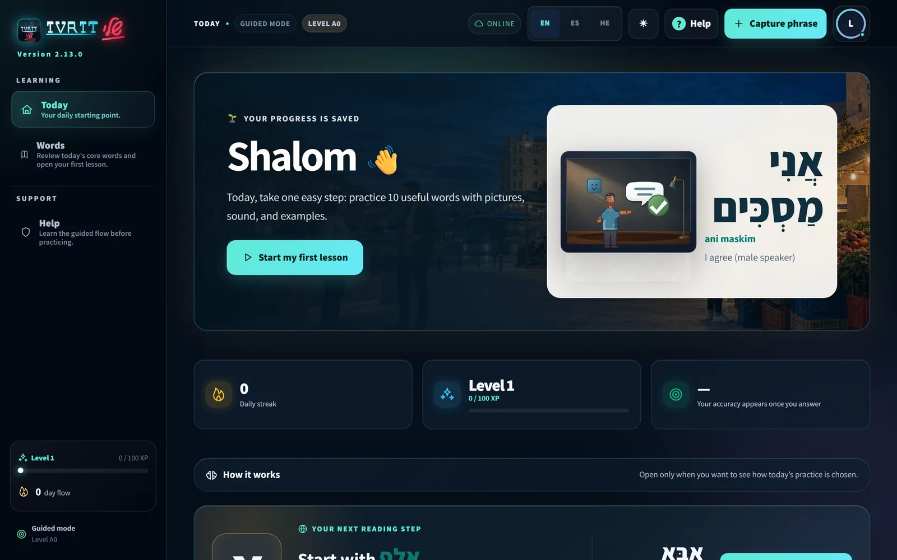

  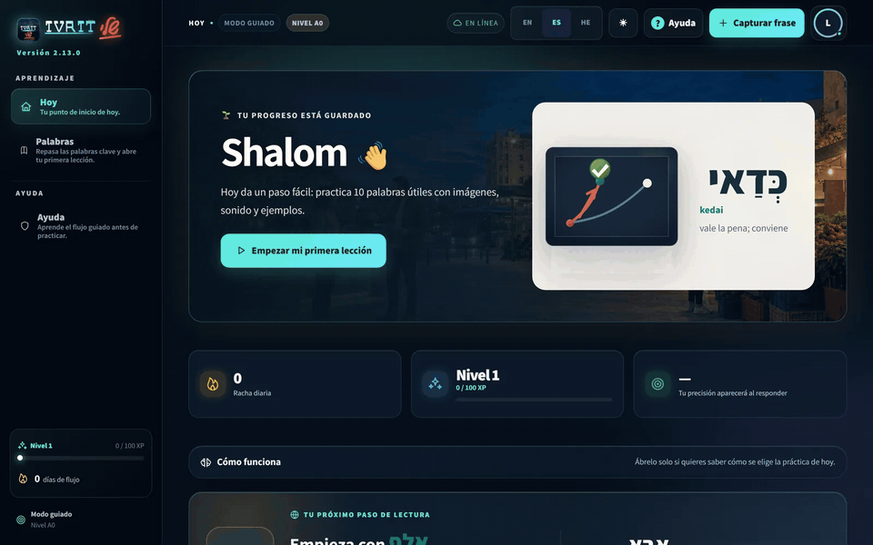

<em>A ten-second, non-looping tour: privacy-reviewed 2.13.0 candidate captures in English and Hebrew and the painted-scene showcase.</em>

<table>
  <tr>
    <td width="40%" align="center"><strong>Responsive mobile flow</strong></td>
    <td width="60%" align="center"><strong>Real Hebrew RTL layout</strong></td>
  </tr>
  <tr>
    <td>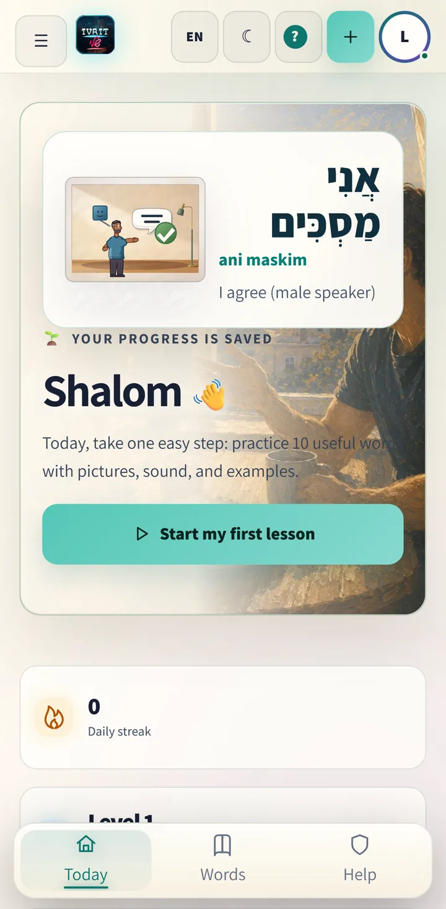</td>
    <td>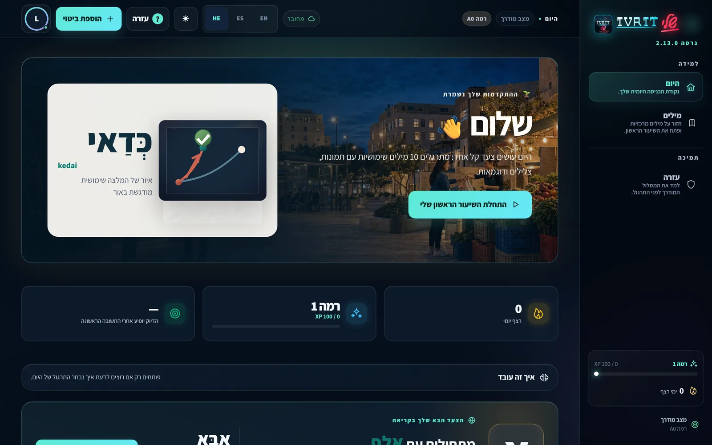</td>
  </tr>
</table>

<table>
  <tr>
    <td width="50%" align="center"><strong>Alphabet Studio</strong></td>
    <td width="50%" align="center"><strong>Linked dictionary</strong></td>
  </tr>
  <tr>
    <td>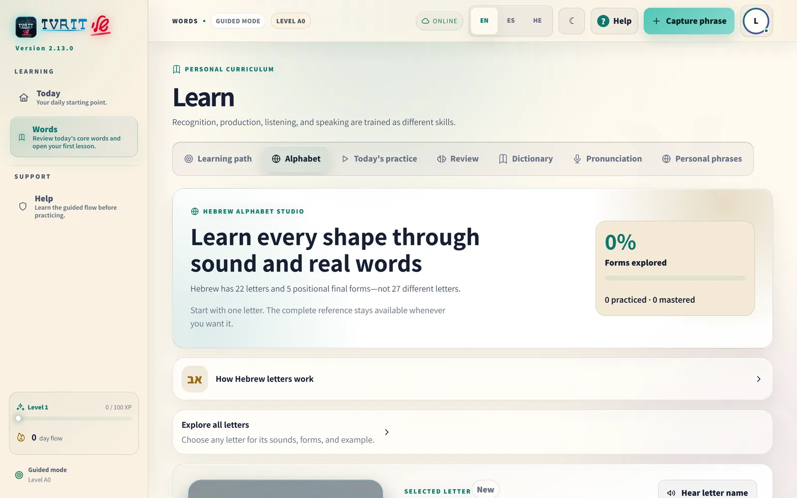</td>
    <td>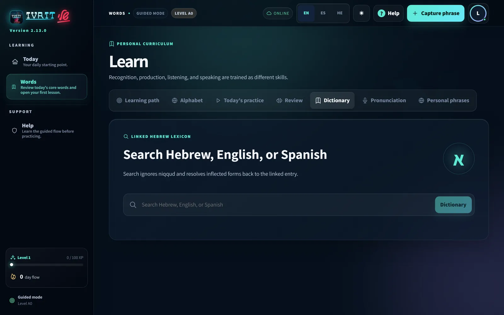</td>
  </tr>
</table>

These five WebP assets — English, plus the Hebrew RTL frame; the Spanish interface is one tap away
in the app — were captured on 2026-11-02 Asia/Jerusalem from a fresh, generic local learner with no personal progress, built from a clean commit. Every
image was reviewed at full size, at GitHub display scale and in grayscale. The GIF
was rendered twice to byte-identical output, checked frame by frame, and contains
no loop extension. Hashes, physical dimensions, source PNG hashes, locale,
direction, viewport, timestamps, privacy findings and process provenance are
recorded in the
[`2.13.0 candidate visual-proof manifest`](assets/readme/proof/2.13.0/manifest.json).
The [`2.12.3 candidate proof`](assets/readme/proof/2.12.3/manifest.json) and the
immutable [`2.12.2 published visual record`](assets/readme/proof/2.12.2/manifest.json)
remain preserved separately; the before-and-after sheets from the 2.13.0 art pass
are kept in [`art-pass`](assets/readme/proof/2.13.0/art-pass/manifest.json).

## ⚡ Tech Stack & Architecture

  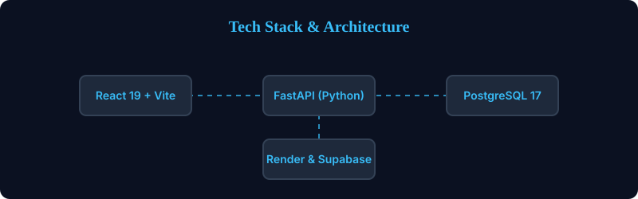

Ivrit Sheli is designed as a local-first offline-capable PWA with a resilient cloud backup backend.

- **Frontend:** React 19, TypeScript, Vite, IndexedDB (Dexie) for local-first storage.
- **Styling:** Vanilla CSS variables, responsive fluid typography, and native RTL logic (`dir="rtl"`).
- **Backend:** FastAPI, Python 3.12, SQLModel (Pydantic), strict OAuth2 stateless sessions.
- **Database:** SQLite (local offline mode) & PostgreSQL 17 (Cloud sync).
- **Infra:** Docker, Render (Live Web Service), Supabase (PostgreSQL with IPv4 Session Pooler).
- **Testing:** 1000+ automated tests across Playwright, Vitest, and Pytest.

## 📚 Documentation

For deep technical dives, deployment runbooks, or local installation, please refer to the dedicated documentation:

- [🚀 Installation Guide (INSTALL.md)](docs/INSTALL.md)
- [🎨 Visual Bible & Brand](docs/VISUAL_BIBLE.md)
- [🏗️ Architecture Deep Dive](docs/ARCHITECTURE.md)
- [🌐 Live Deployment Rules](docs/DEPLOYMENT.md)
- [🔒 Privacy & Data Ownership](PRIVACY.md)
- [🧪 Test Reports](TEST_REPORT.md)

## 👤 Author and License

Built with ❤️ by **Kevin Cusnir / [Lirioth Teltanion](https://github.com/LiriothTeltanion)**.
Built with AI-assisted tooling; I reviewed, tested and can explain every change.
Released under the [MIT License](LICENSE).
