# Art and interface evolution — wiki for agents

Last updated: 2026-11-05. Owner: Kevin Cusnir (creative alias Lirioth Teltanion).
Source of truth: this repository (`liriothteltanion/ivritsheli`), branch `main`. This file is a map, not a spec: when it disagrees with the code, the code wins.
On 2026-11-05 `main` was exactly tag `v2.13.0` (commit `5ff54d2`), 236 commits.

Status labels used below: CONFIRMED = read in the repo; NOT_VERIFIED = stated but not checked.
Re-check anything that can drift (versions, counts, open gates) against the repo before you rely on it.

## 1. What the app is
- Trilingual (ES / EN / HE with RTL) Hebrew-learning web app. Frontend React + TypeScript + Vite; backend FastAPI (Python). CONFIRMED.
- Words are taught with one exact illustrated scene per word: 240 scenes in 20 categories of 12. CONFIRMED.

## 2. Release timeline (dates are commit dates)
| Date | Version | Commit | What changed for art/UI |
|---|---|---|---|
| 2026-07-15 | 1.0 | `3c746c9` | Own SVG brand, badges, first UI preview. |
| 2026-07-16 | 2.0 Cloud Edition | `eea8993` | Neon dark UI, "ע" orb, trilingual EN/ES/HE with RTL, emoji cues. |
| 2026-07-22 | 2.5 | `36c9791` | Living Atlas of Israel. |
| 2026-07-26 | 2.8 / 2.8.2 / 2.8.3 | `7195b7c`, `fce1218`, `7adc204` | Regional paintings; semantic SVG engine (24 then 72 scenes); context → meaning → anchor layers. |
| 2026-08-10/11 | 2.10 | `1a0c5e5`, `3078fc2`, `d475304` | 240/240 exact scenes; outline 2.8→1.5 and 76%→42%; Playwright QA of all 240; lazy art chunk (entry 781→511 kB). |
| 2026-08-14 | 2.11 Field Notes / 2.12 Nocturne | `6d6aa6f`, `cea4237`, `b84a448`, `b7d29d4`, `41b75d2`, `72719f7` | Six spatial-family references; shared adult character; lit-edge stroke 82%/4 → 55%/2.5; hour vs minute separated. |
| 2026-08-23/24 | 2.12.2 candidate | `1e4281e`, `db51b1c`, `0042ae5`, `b749dc6`, `1e512f6` | 26 repaint candidates; icon "שלי" from Gveret Levin outlines; wordmark; avatars 6.8 MB → 164 kB; 758-line CSS brace bug. |
| 2026-08-27 | 2.12.2 / 2.12.3 | `c1e4322`, `ea8aff8` | Proof screenshot sets; "one" changed from raised finger to one coffee cup. |
| 2026-10-18 → 2026-11-03 | 2.13.0 "Living Painted Scenes" | PR #81 `7a4756a`, `9d64fc7`, tag `5ff54d2` | Painted gouache backdrops (with dark versions) behind SVG scenes; one family of adults; scenes animate once on entering view (4.8 s). |

## 3. Art system
- Scenes are deterministic SVG React components: `frontend/src/components/semantic-scenes/*`, styled by `frontend/src/components/semantic-word-illustration.css`; the pilot scenes also use `living-scene-pilot.css`. CONFIRMED.
- Recipes and the list of 240 keys: `frontend/src/visuals/a0VisualRecipes.ts`. Words, glosses and alt texts: `backend/src/ivrit_sheli/dictionary.py` and `starter_lexicon_v*.py`. CONFIRMED.
- Painted backdrops: `frontend/public/art-direction/living-scenes/painted/` (light + `-dark` variants). CONFIRMED.
- The repo reports 157 of 165 "paintable" scenes painted in 2.13.0; the other 75 scenes are diagrams on purpose. In our own render, 173 of 240 scenes reference at least one painted image (this count includes shared walls and the shared desk). CONFIRMED (both numbers, different definitions).
- Art docs: `docs/VISUAL_BIBLE.md`, `docs/VISUAL_ASSET_MANIFEST.md`, `docs/LIVING_SCENES_PILOT.md`, `docs/LIVING_SCENES_ART_PROMPTS.md`. CONFIRMED (files exist).

## 4. Tools used for art (from commits, changelog and manifests)
- SVG in React + TypeScript; Vitest; Playwright visual QA.
- 2026-08-14: OpenAI image generation inside Codex (regional series); ChatGPT Pro image generation (six references); Claude Opus 5; Pillow (WebP).
- 2026-08-24: Imagen in Antigravity (concept art); fontTools + Gveret Levin (OFL) for the icon; Assistant typeface.
- 2026-10-20 → 11-02: Gemini image generation in Antigravity via Nova Bridge for backdrops; Pillow; `compose-living-scenes.py`.
- The tool that produced the July regional WebP images is not recorded in the repo. NOT_VERIFIED.

## 5. Interface screenshots in the repo (where to find each era)
- 2.0: `assets/readme/ivrit-sheli-2-{dashboard,hebrew-rtl,mobile}.png` (commit `eea8993`).
- 2.8: `assets/readme/ivrit-sheli-2.8-{dashboard,hebrew-rtl,mobile,welcome}.png`, `ivrit-sheli-2.8-journey.gif` (`46fc9ff`).
- 2.10: `assets/readme/ivrit-sheli-2.10-{dashboard,hebrew-rtl,mobile}.png` (`3078fc2`).
- 2.12.2, 2.12.3, 2.13.0 proof sets: `assets/readme/proof/<version>/` (today, dictionary, alphabet, phone, Hebrew, tour GIF).
- `assets/readme/screenshots/*.png` and the two `ivrit_sheli_*.jpg` (commit `7d27a4d`, 2026-08-27): the commit message calls them "generated high-fidelity UI concept art for portfolio". Treat them as portfolio material, not as proof of the running app.
- `assets/readme/screenshots/hero_composed.jpg` and `themes_composed.jpg`: real screenshots composited over generated backgrounds (commit `e2fad25` says so); updated for 2.13.0 in `9d64fc7`.
- No interface screenshots exist in the repo for 1.0 or for 2.4–2.5 apart from the 2.5 atlas.

## 6. Interface at a glance
Screenshots already in this repo, oldest first. Relative links, so they render on GitHub.

| Version | Today (desktop) | Phone |
|---|---|---|
| 2.0 · 2026-07-16 | 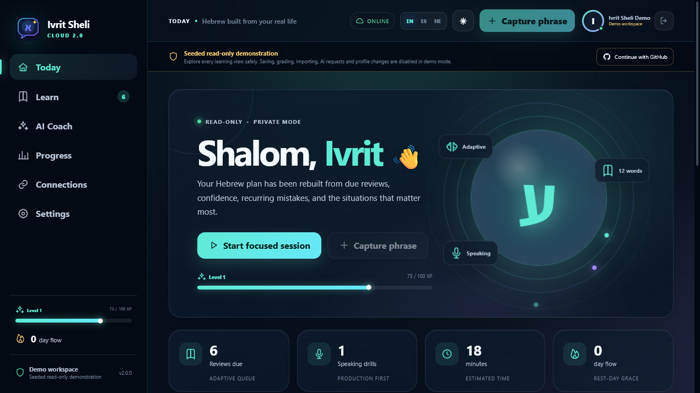 | 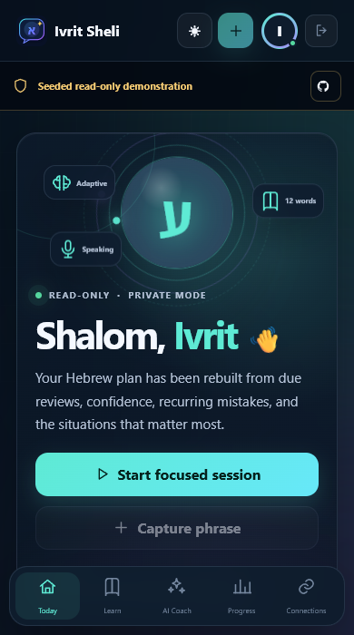 |
| 2.8 · 2026-07-26 | 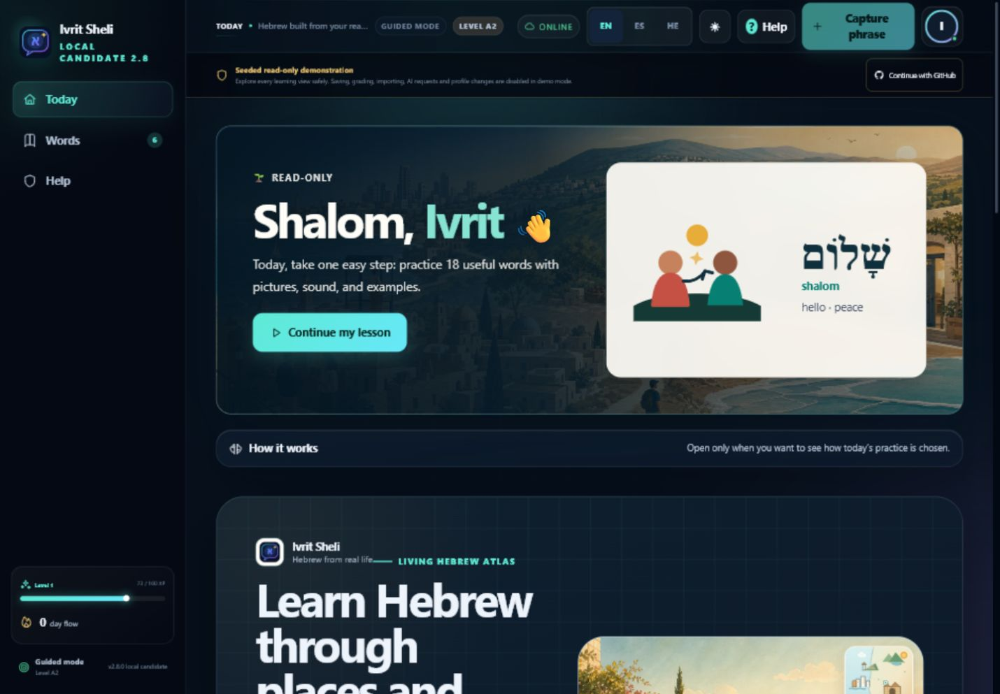 | 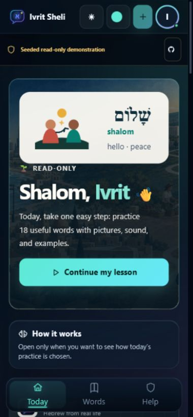 |
| 2.10 · 2026-08-11 | 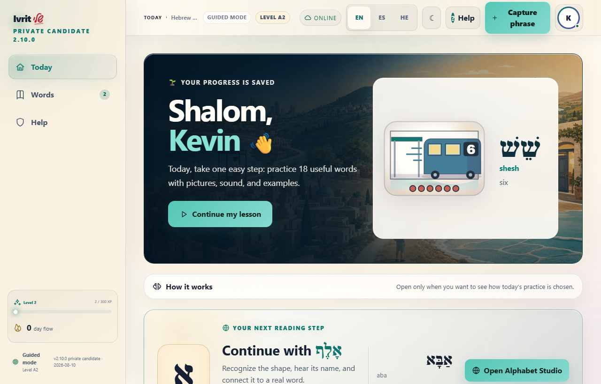 | 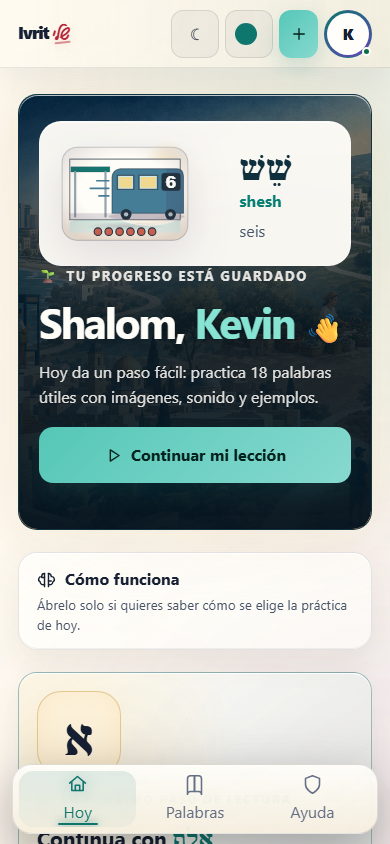 |
| 2.12.3 · 2026-08-27 | 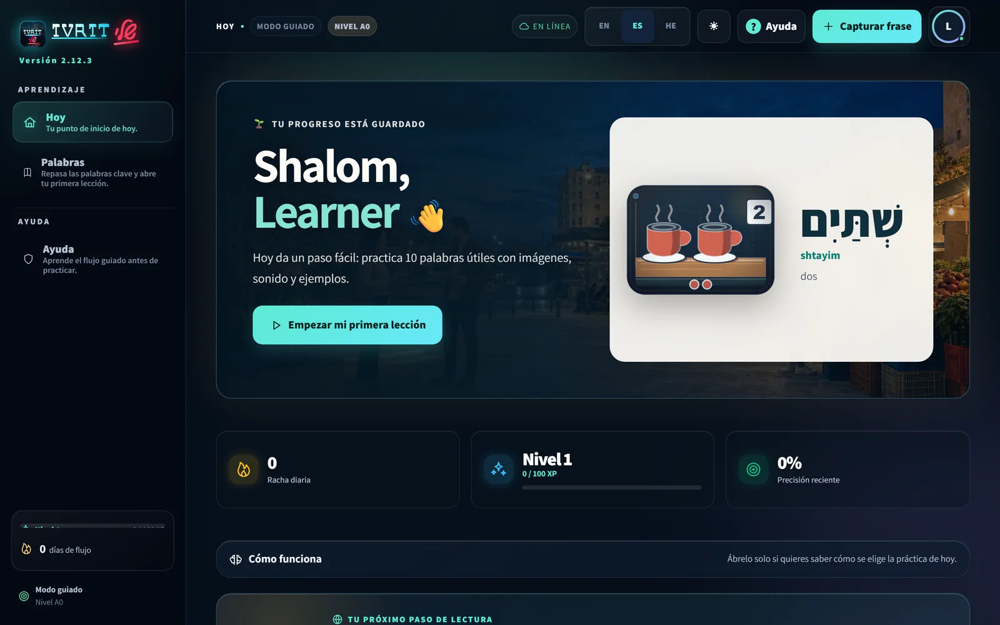 | 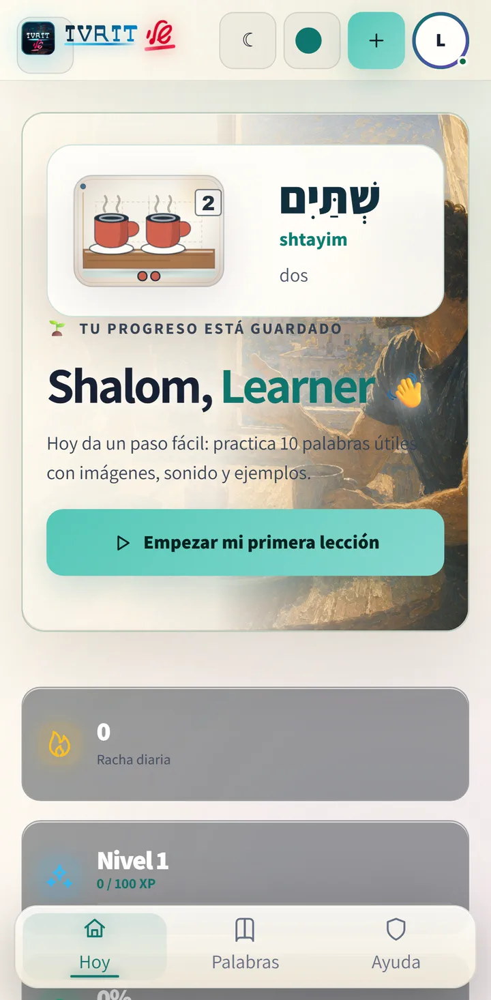 |
| 2.13.0 · 2026-11-02 | 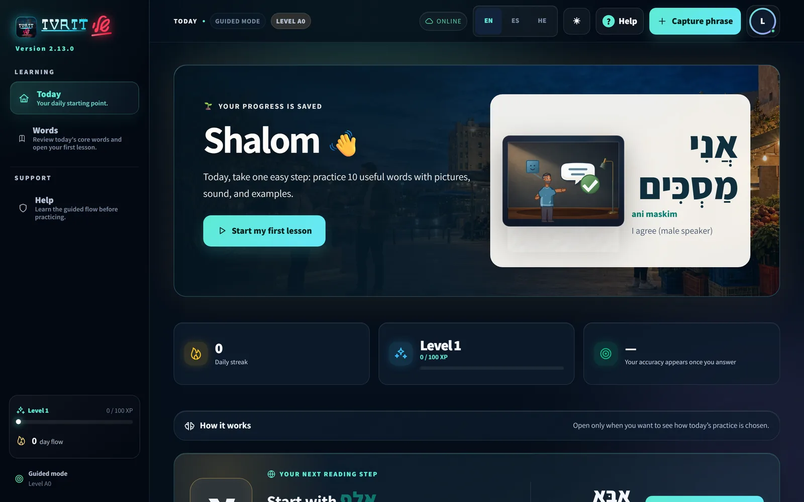 | 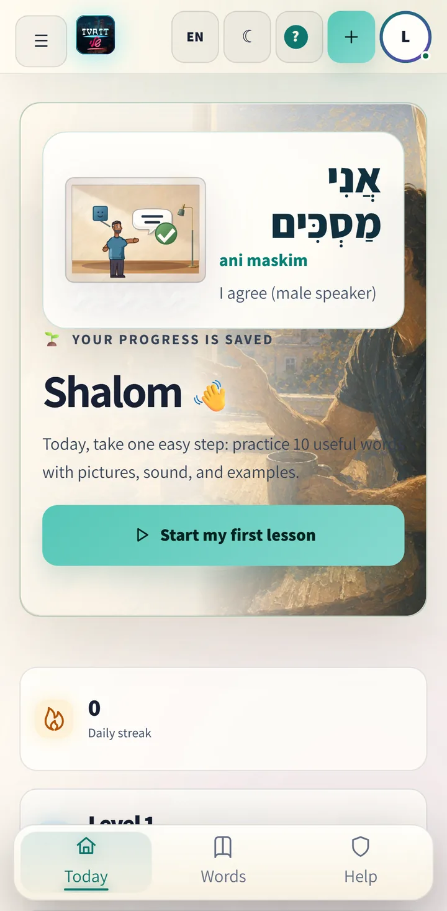 |

Hebrew (RTL) versions of the same screens: `ivrit-sheli-2-hebrew-rtl.png`, `ivrit-sheli-2.8-hebrew-rtl.png`, `ivrit-sheli-2.10-hebrew-rtl.png` in `assets/readme/`, and `today-desktop-dark-he.webp` in the 2.12.2 and 2.13.0 proof sets.
The 2.13.0 art pass before/after images are in `assets/readme/proof/2.13.0/art-pass/`.

## 7. Scene evolution, word by word
Each strip shows one scene in five versions, left to right: 2.8.3 (2026-07-26), 2.10 (2026-08-11), Nocturne (2026-08-14), 2.12.3 (2026-08-27) and 2.13.0 (2026-11-03). A grey tile means the scene did not exist yet. These are renders from each commit's source (see section 9), not screenshots.

| Word | Five versions |
|---|---|
| שלום · shalom · hello | 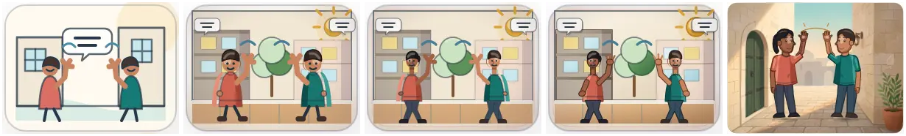 |
| בוקר טוב · boker tov · good morning | 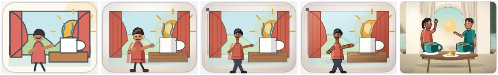 |
| לחם · lekhem · bread | 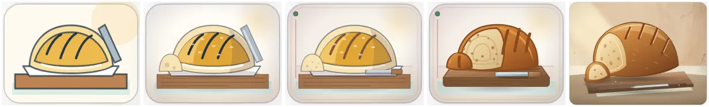 |
| מים · mayim · water | 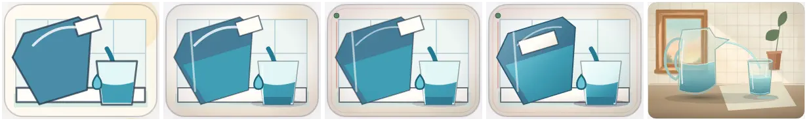 |
| קפה · kafe · coffee | 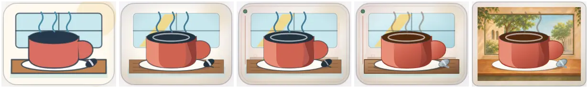 |
| אחת · akhat · one | 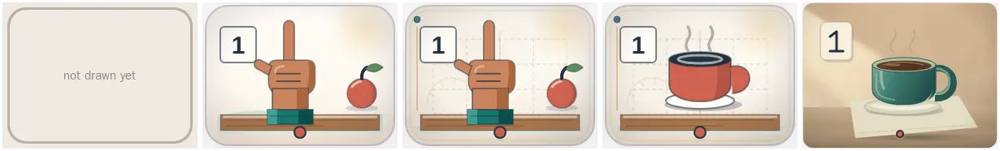 |
| לכתוב · likhtov · to write | 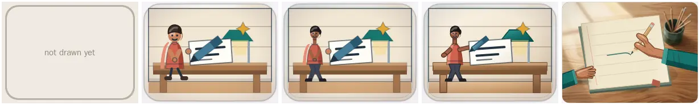 |
| שעה · sha'a · hour | 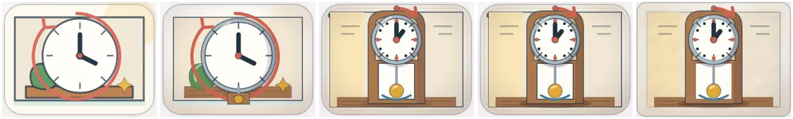 |
| אוטובוס · otobus · bus | 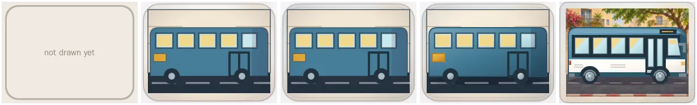 |
| אמא · ima · mother | 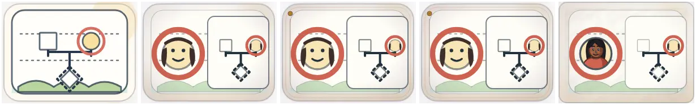 |

## 8. Open gates in v2.13.0 (as stated by the repo on 2026-11-03)
- Human 5-second recognition test of each scene.
- Native Hebrew review of the new 2.13 texts.
- Pilot with Kevin's mother; findings planned for 2.13.1.
- Live PostgreSQL integration.

## 9. Companion visual page
- A private visual companion (timeline, 10-word deep dive, gallery of all 240 scenes in five versions, interface screenshots) was built on 2026-11-04/05 outside this repo. It is not published, so agents should not expect to open it.
- How its scene images were made, so the method can be repeated: each scene was rendered with `react-dom/server` from the source of commits `7adc204`, `3078fc2`, `41b75d2`, `ea8aff8` and tag `v2.13.0`, with that commit's CSS, light theme, card size 240×180, no animation, then rasterized with headless Chromium. They are renders, not screenshots of the app at the time.
- Change percentages were measured with ImageMagick (`compare -metric AE -fuzz 2%`) against the previous version.
